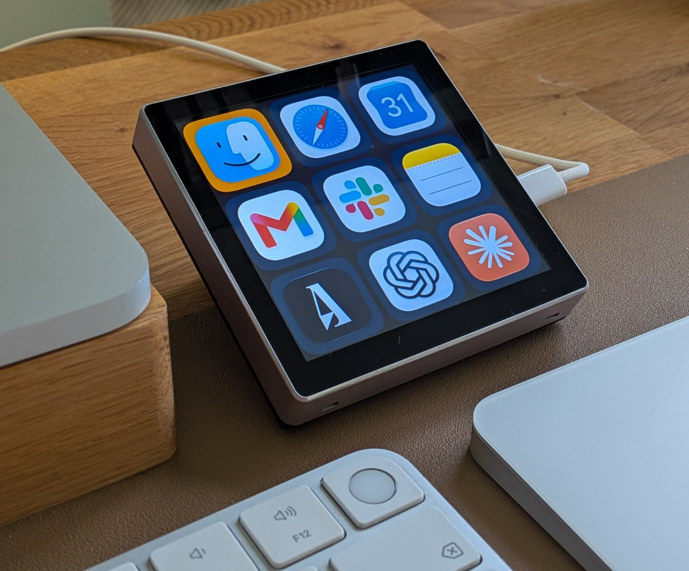
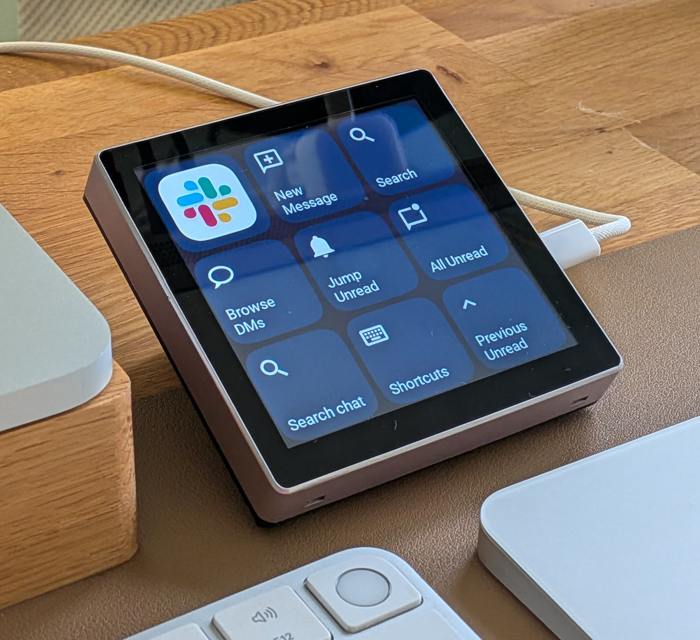

# EspDesktop

**Turn a small touchscreen into a dedicated controller for your Mac.**

EspDesktop pairs an affordable ESP32 touchscreen with a native macOS menu-bar app through the **Mac Companion** connector. Use the display to launch apps, open folders and websites, run keyboard shortcuts and Apple Shortcuts workflows, control OBS Studio, and lock your Mac.

Set up the display from a normal web browser.

A [Windows 11 companion preview](windows/README.md) is available for testing on Intel, AMD, and Arm PCs.

**Documentation and setup guides:** [espdesktop.com](https://espdesktop.com/)

## What You Can Control

- **Applications** — launch only the Mac apps you approve in EspDesktop.
- **App keyboard shortcuts** — open an app-specific page of controls for common actions, or create your own keyboard shortcuts.
- **Apple Shortcuts** — run a workflow from the Mac’s Shortcuts app with a tap, or group several workflows on a dedicated page. Your Mac must be unlocked. [Set up Apple Shortcuts](https://espdesktop.com/mac-controls/apple-shortcuts).
- **OBS Studio** — switch scenes, adjust mixer levels, mute inputs, and control streaming, recording, and Studio Mode. Connect EspDesktop to OBS using the built-in OBS WebSocket server. [Set up OBS Studio controls](https://espdesktop.com/mac-controls/obs-studio).
- **Lock Machine** — lock your Mac with a tap on the display.
- **Finder folders** — open an approved folder with a tap.
- **Websites** — open `http://` and `https://` links in your default browser.

You can organise controls into subpages, resize and rearrange cards, change icons and colours, and back up or restore the layout from the display’s built-in editor. Apple Shortcuts and OBS Studio controls are available in [EspDesktop v1.4.1](https://github.com/jtenniswood/espdesktop/releases/tag/v1.4.1).

## How It Works

1. **Install EspDesktop firmware** on a supported touchscreen from Chrome or Edge.
2. **Connect the display to 2.4 GHz WiFi.**
3. **Install the EspDesktop Mac app** using the current steps on the [documentation site](https://espdesktop.com/screens/4848s040#download).
4. **Pair the Mac and display.** Open the display's web settings, choose **System → Mac Companion**, and enter the temporary code in the Mac app.
5. **Approve access.** Choose the applications and folders the display may use. macOS Accessibility permission is needed for keyboard shortcuts and Lock Machine.
6. **Build your control surface.** Add Companion cards and arrange them from the display's web page.

Start by [choosing your display](https://espdesktop.com/getting-started/choose-a-display), then follow the installation and Mac pairing steps for that model. For public firmware, install the firmware and Mac app from the same EspDesktop release. For the V3 test build, check [Companion compatibility](https://espdesktop.com/reference/companion-compatibility).

## Designed to Stay Narrow

EspDesktop is a local companion, not remote desktop software. The Mac app connects to the paired display on your local network and limits it to a small set of defined actions.

- Pairing uses a temporary code, a credential stored in macOS Keychain, and certificate pinning.
- Applications and folders must be approved on the Mac before the display can use them.
- Folder paths remain on the Mac; the display receives only a friendly name and an anonymous identifier.
- Web cards accept only `http://` and `https://` links.
- The connector does not run shell commands or accept incoming network connections on the Mac.

Pair on a trusted local network and remove a display from the Mac app before replacing or re-pairing it.

## What You Need

- A [4-inch Guition ESP32-S3 4848S040](https://espdesktop.com/screens/4848s040) touchscreen with public firmware. The [7-inch Guition JC1060P470 V3](https://espdesktop.com/screens/jc1060p470-v3) and [10.1-inch Guition JC8012P4A1 V3](https://espdesktop.com/screens/jc8012p4a1-v3) use test firmware.
- A USB-C data cable for the first firmware install
- Chrome or Edge for browser-based flashing
- A 2.4 GHz WiFi network shared by the display and Mac
- An Apple silicon Mac running macOS 13 or newer

The 4848S040 panel is available from AliExpress ([US](https://s.click.aliexpress.com/e/_c3qyIYL7) or [Global](https://s.click.aliexpress.com/e/_c4m73SzH)). A compatible [3D-printable stand is available on MakerWorld](https://makerworld.com/en/models/3592833-espdesktop-4inch-screen-stand#profileId-4115394).

## Project Links

- [Choose a display and install EspDesktop](https://espdesktop.com/getting-started/choose-a-display)
- [Install and pair the Mac app](https://espdesktop.com/screens/4848s040#download)
- [Mac controls](https://espdesktop.com/#what-you-can-control)
- [Companion compatibility](https://espdesktop.com/reference/companion-compatibility)
- [Report a bug or request a feature](https://github.com/jtenniswood/espdesktop/issues)

## Development

The repository contains both the display firmware and the native macOS app. See [DEVELOPERS.md](DEVELOPERS.md) for the development workflow and [macos/EspDesktop/README.md](macos/EspDesktop/README.md) for Mac app build and packaging details.

After changing card configuration, the web setup page, or generated device files, run:

- `npm run check:product`
- `npm run check:fast`
- `npm run check:web-browser-smoke`
- `npm run docs:build`

## License

EspDesktop is licensed under the [PolyForm Noncommercial License 1.0.0](LICENSE). You can view, change, and share the software for non-commercial purposes. Commercial use needs separate permission from the project owner.

Required notice: see [NOTICE](NOTICE).

## Support This Project

If EspDesktop is useful to you, you can support ongoing development by buying me a coffee.

